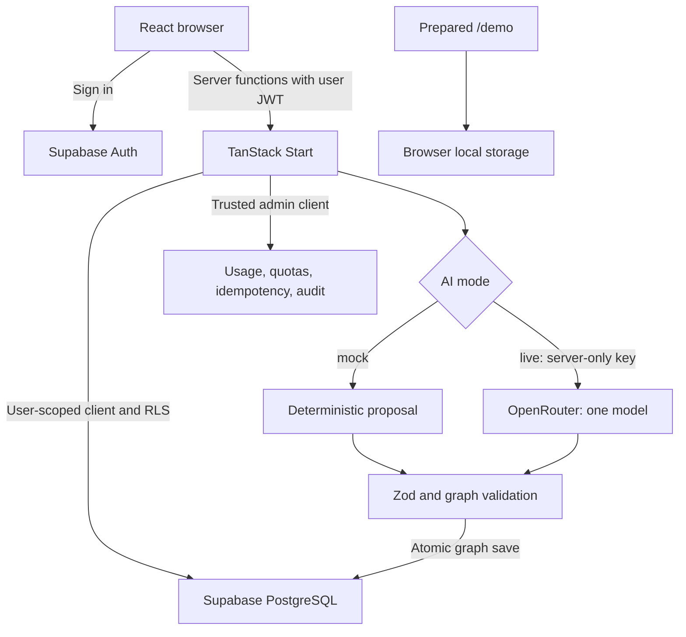

# ReversePath

**Start at the outcome. Work backwards to your next action.**

ReversePath turns a goal, problem, decision, or uncertain idea into a structured plan. It maps requirements and gaps, compares strategies, identifies the current bottleneck, and ranks work you can start now. Track progress, record changed circumstances, and review revised plans before accepting them.

Built with React and TanStack Start, Supabase for authentication and persistent data, and OpenRouter for live AI inference. Deterministic mock AI and a prepared offline demo are also included.

## Features and workflow

1. **Describe an objective.** Intake classifies the intent and derives a title, desired outcome, success criteria, clarity score, and any stated time horizon.
2. **Clarify your context.** Answer material questions and add resources, constraints, preferences, facts, or measures. Edit the normalized objective and remove context facts.
3. **Generate a plan.** Choose a conservative, balanced, or aggressive scenario. Review strategies, trade-offs, requirements, gaps, milestones, actions, experiments, assumptions, risks, feasibility, confidence, and the bottleneck.
4. **Choose a strategy and act.** Override the recommendation. Review ranked ready actions and blocked work, edit action details, start or complete work, defer, skip, or block actions, and confirm milestones.
5. **Check in.** Save notes, a progress rating, and changed facts. Low ratings or changed facts can suggest replanning.
6. **Review revisions.** Replanning creates a candidate version with a change summary. Accept it to replace the active version or reject it to keep the current plan. Inspect previous versions at any time.

The dashboard lists your objectives and supports deleting an objective and its derived plan data. Account settings offer a JSON export of the twelve planning-data tables and sign-out controls.

### Three operating modes

| Mode                        | Authentication and persistence                      | AI behavior                                                |
| --------------------------- | --------------------------------------------------- | ---------------------------------------------------------- |
| Prepared `/demo`            | No account; progress stays in browser local storage | Curated six-month product-management example; no inference |
| Authenticated mock planning | Supabase account and configured database            | Labeled, deterministic proposals; no external AI calls     |
| Authenticated live planning | Supabase account and configured database            | Structured proposals generated through OpenRouter          |

Mock mode replaces inference only; the authenticated workspace still requires Supabase.

## Routes

| URL              | Purpose                                                       | Access                                   |
| ---------------- | ------------------------------------------------------------- | ---------------------------------------- |
| `/`              | Landing page or signed-in plans dashboard                     | Public; personal data requires a session |
| `/auth`          | Email/password signup and sign-in; Google OAuth button        | Public                                   |
| `/demo`          | Prepared plan with completion, refresh persistence, and reset | Public                                   |
| `/new`           | New objective intake                                          | Sign-in required                         |
| `/plans/$caseId` | Context, planning, execution, check-ins, and version review   | Sign-in and ownership required           |
| `/settings`      | Account email, planning-data export, sign out                 | Sign-in required                         |

`$caseId` is an intake-case UUID, not a plan UUID. Google sign-in requires provider configuration in Supabase.

## Technology and architecture

| Layer         | Implementation                                                              |
| ------------- | --------------------------------------------------------------------------- |
| UI            | React 19, TypeScript, Tailwind CSS 4, Radix/shadcn-style components, Sonner |
| Application   | TanStack Start SSR and server functions, TanStack Router, TanStack Query    |
| Build/runtime | Vite 8, Nitro Node server or Vercel preset; Node 24 project baseline        |
| Auth/data     | Supabase Auth, PostgreSQL, row-level security (RLS)                         |
| AI            | AI SDK, OpenAI-compatible OpenRouter transport, Zod contracts               |
| Verification  | Vitest, Playwright Chromium, TypeScript, ESLint, Prettier, secret scanner   |



Global function middleware in `src/start.ts` attaches the browser session's bearer token. Protected server functions validate JWT claims and create a user-scoped database client. RLS and ownership triggers constrain user records and their parent/child relationships. Server-function requests also pass through CSRF middleware.

The privileged server client handles usage records, quota checks, idempotency receipts, and audit events. Ordinary planning-data operations use the authenticated user's client. Provider credentials stay in server modules.

Live inference uses the fixed endpoint `https://openrouter.ai/api/v1`. All logical model roles use `OPENROUTER_MODEL_DEFAULT`; there is no alternate-provider fallback. Responses pass structured-output contracts and graph validation before graph persistence. Live failures surface as errors rather than silently returning mock output. A deterministic node diff keeps candidate review available if the extra AI change-explanation call fails.

## Run locally

Use **Node.js 24** and npm. `package-lock.json` is the committed dependency lockfile.

```powershell
npm ci
if (!(Test-Path .env)) { Copy-Item .env.example .env }
```

Edit `.env` privately with the Supabase values below. Preserve an existing configured file. Keep `AI_PROVIDER_MODE=mock` for development without paid inference.

```powershell
npm run check:env
npm run dev
```

Open [http://localhost:5173](http://localhost:5173). Visit `/demo` for the prepared example, or sign in to create and save your own plans.

For a UI-only look at the landing page and demo, `npm ci` and `npm run dev` can run without service credentials. Authentication reports missing configuration, and `check:env` fails until the workspace settings are supplied.

## Environment configuration

Start with [`.env.example`](.env.example). See [the hosting checklist](docs/VERCEL_ENV_SETUP.md) for deployment details; runtime behavior in source takes precedence where older documentation differs.

### Required for the authenticated workspace

| Variable                        | Purpose                                                        |
| ------------------------------- | -------------------------------------------------------------- |
| `VITE_SUPABASE_URL`             | Public Supabase URL included in the browser build              |
| `VITE_SUPABASE_PUBLISHABLE_KEY` | Public browser publishable key                                 |
| `SUPABASE_URL`                  | Same project URL for the server                                |
| `SUPABASE_PUBLISHABLE_KEY`      | Same publishable key for user-scoped server requests           |
| `SUPABASE_SERVICE_ROLE_KEY`     | Server-only modern `sb_secret_` key or legacy service-role JWT |

The URL pair must match, and the publishable-key pair must match. Never put server secrets or OpenRouter keys in `VITE_*` variables. Environment files are ignored except for `.env.example`.

### Live AI

Configure these values privately in `.env`:

```dotenv
AI_PROVIDER_MODE=live
OPENROUTER_API_KEY=<your-openrouter-key>
OPENROUTER_MODEL_DEFAULT=openai/gpt-4.1-mini
```

The model above is recorded in the repository's verification reports. Validate your selected model against the current catalog:

```powershell
npm run check:env
npm run check:ai
```

`check:ai` contacts OpenRouter to validate the key and check `structured_outputs` and `response_format` support. It does not generate text. Restart the development server after configuration changes. Missing or unrecognized runtime modes default to mock; `check:env` rejects invalid mode names.

### Optional runtime controls

| Variable                                | Default / behavior                                                               |
| --------------------------------------- | -------------------------------------------------------------------------------- |
| `OPENROUTER_ENABLED`                    | Set `false` to disable live inference; does not switch live requests to mock     |
| `PUBLIC_APP_URL`                        | Optional OpenRouter attribution URL; auth redirects use the browser origin       |
| `AI_PROVIDER_TIMEOUT_MS`                | 90,000 ms per attempt; maximum 300,000                                           |
| `AI_PROVIDER_MAX_RETRIES`               | 0; maximum 3 retries against the same provider                                   |
| `AI_MAX_OUTPUT_TOKENS`                  | 12,000; accepted override range 256–16,384                                       |
| `AI_DAILY_REQUEST_LIMIT`                | Shared override for per-user, per-operation limits over a rolling 24-hour window |
| `AI_LIMIT_CLASSIFY_AND_CLARIFY_PER_DAY` | Intake override; code default 20                                                 |
| `AI_LIMIT_GENERATE_PLAN_GRAPH_PER_DAY`  | Generation override; code default 10                                             |
| `AI_LIMIT_REPLAN_PER_DAY`               | Replan override; code default 10                                                 |
| `SUPABASE_STORAGE_BUCKET`               | `reversepath-files`, for the standalone storage adapter                          |

Operation-specific quotas take precedence over the shared override. Mock workspace requests still pass through usage and quota handling.

`APP_ENV`, `VITE_AUTH_PROVIDER`, and `AI_GENERATION_ENABLED` appear in configuration material but are not read by application runtime code. The environment checker accepts only `supabase` or an omitted `VITE_AUTH_PROVIDER`. Use `OPENROUTER_ENABLED=false` for the implemented live-inference switch. Legacy provider keys, per-role model settings, custom provider endpoints, and `SUPABASE_TEST_*` credentials are unused.

## Database and authentication setup

The canonical schema history is in [`supabase/migrations`](supabase/migrations). Eight checked-in migrations establish the schema, ownership constraints, restricted helpers, and transactional planning operations.

For the existing project, inspect migration history and apply only reviewed missing changes. Do not reset the remote database, replay applied migrations, or use `FINAL_REMOTE_BOOTSTRAP.sql` and `LOCALHOST_BACKEND_PATCH.sql` as routine startup scripts. For a separate empty database, provision the migrations in timestamp order through your Supabase migration workflow. Vite does not install the schema automatically. `supabase/config.toml` identifies the existing project: verify the target before database operations.

| Area            | Tables                                                |
| --------------- | ----------------------------------------------------- |
| Account         | `profiles`                                            |
| Intake/context  | `intake_cases`, `case_context_facts`                  |
| Plans/history   | `plans`, `plan_versions`, `plan_changes`              |
| Graph/execution | `strategies`, `plan_nodes`, `plan_edges`, `actions`   |
| Review          | `assumptions`, `risks`, `check_ins`                   |
| Operations      | `ai_usage_events`, `idempotency_keys`, `audit_events` |

Graph saving, version activation, execution edits, strategy selection, and check-ins use `persist_plan_graph`, `activate_plan_version_for_user`, `update_execution_node`, `select_plan_strategy`, and `save_plan_check_in`. Transactions and locks keep each operation consistent, including prerequisite checks and concurrent version allocation.

Configure Supabase Auth with email/password authentication and confirmation-email delivery. Set the hosted Site URL and allow intended local, Preview, and Production redirect origins. Signup and Google OAuth request `window.location.origin`. Configure Google in Supabase if that sign-in option is needed.

The server-side storage adapter supports uploads, signed read URLs, and deletion, but current product routes do not call it. There is no attachment upload interface, and migrations do not create its default bucket. JSON exports download directly through the browser.

## Planning and execution rules

- AI proposes; deterministic code controls graph validation, ranking, persistence, and version transitions.
- Proposals require exactly one objective, valid dependency references, no self-links or hard cycles, valid strategy references, and exactly one recommended strategy when strategies exist. Actions and experiments require completion criteria and expected results. A proposal without executable work must provide an explicit blocker.
- The selected strategy includes shared work and the transitive hard prerequisites of included nodes.
- Hard `REQUIRES`, `PRECEDES`, and `BLOCKED_BY` prerequisites must be **DONE** before dependent work starts or completes. Skipped or cancelled prerequisites do not satisfy the gate. Explicitly blocked nodes remain blocked; deferred nodes are excluded from the frontier.
- Ready actions and experiments rank by `impact × successLikelihood × urgency × dependencyLeverage / max(effortCost, 0.25)`, with reasons shown. Ranking, feasibility, and confidence scores are heuristics rather than calibrated probabilities.
- Progress counts completed actions, experiments, and milestones within the selected execution scope.
- Initial generation activates a version. Replanning creates a `CANDIDATE`; acceptance makes it `ACTIVE` and supersedes the previous active version. Rejection preserves the active plan.
- Intake, generation, and replan requests use idempotency keys to detect in-flight duplicates and replay completed results.

## Repository structure

```text
src/
  routes/                   File-based pages and root layout
  components/               App shell and reusable UI primitives
  hooks/                    Session and mobile breakpoint hooks
  domain/                   Graph types, frontier, progress, offline demo
  ai/                       Contracts, prompts, orchestration, mock provider
  integrations/supabase/    Clients, auth middleware, database types
  lib/                      Server functions, planning, execution, quotas, audit
  router.tsx                Router and QueryClient
  start.ts                  Bearer-token, CSRF, and error middleware
  server.ts                 Server entry and SSR error handling
  styles.css, fonts.css     Theme and local-font declarations
scripts/                    Build, env/provider checks, E2E runner, secret scan
supabase/                   Migrations and historical SQL utilities
tests/                      Unit, integration, migration, and browser tests
public/                     Fonts, font licenses, favicon, robots.txt
docs/                       Architecture, setup, and release evidence
```

Server functions are grouped into `intake.functions.ts`, `planning.functions.ts`, `execution.functions.ts`, and `data.functions.ts`. Keep privileged implementations in server modules; client-visible route/function files import them dynamically inside server handlers. Routes follow [these conventions](src/routes/README.md); do not edit the generated `src/routeTree.gen.ts` manually.

## Commands

| Command                         | Purpose                                                                     |
| ------------------------------- | --------------------------------------------------------------------------- |
| `npm run dev`                   | Development server on port 5173                                             |
| `npm run check:env`             | Check config, credential matching, duplicates, and browser-secret exposure  |
| `npm run check:ai`              | OpenRouter credential/capability check without inference                    |
| `npm run typecheck`             | TypeScript check without emitting files                                     |
| `npm run lint`                  | ESLint                                                                      |
| `npm test`                      | Unit, integration, and static migration checks                              |
| `npm run test:unit`             | Unit tests                                                                  |
| `npm run test:integration`      | Integration tests; service tests remain opt-in                              |
| `npm run test:db`               | Static migration assertions; no database connection                         |
| `npm run test:e2e`              | Playwright through the server-managing runner                               |
| `npm run build`                 | Production build; Nitro defaults to Node unless overridden                  |
| `npm run build:node`            | Explicit Node server build                                                  |
| `npm run start`                 | Run `.output/server/index.mjs`, loading `.env` if present                   |
| `npm run build:vercel`          | Explicit Vercel build                                                       |
| `npm run build:dev`             | Build in Vite development mode                                              |
| `npm run preview`               | Vite preview                                                                |
| `npm run format`                | Rewrite repository formatting                                               |
| `node scripts/scan-secrets.mjs` | Scan tracked text and generated client assets for supported secret patterns |

## Testing

Ordinary tests cover output normalization, graph validation, frontier behavior, strategy scope, progress, diffs, idempotency, quotas, auth errors, transactional execution handling, a deterministic workflow harness, and OpenRouter transport with mocked HTTP. Migration tests inspect SQL; they do not prove a remote schema is installed.

```powershell
npm run typecheck
npm run lint
npm test
npx playwright install chromium
npm run test:e2e
```

The E2E runner starts Vite at `http://127.0.0.1:4173` and stops it afterward. Override `PLAYWRIGHT_PORT` to change the port. Set `PLAYWRIGHT_BASE_URL` to use an existing local or hosted server; the runner then neither starts nor configures the server. Authenticated E2E tests use the target server's AI mode.

### Opt-in external tests

These use the primary Supabase credentials and disposable users. Gates are off by default; ordinary tests do not intentionally make paid inference calls.

| Gate                          | Behavior                                                                                    |
| ----------------------------- | ------------------------------------------------------------------------------------------- |
| `RUN_SUPABASE_RLS_TESTS=true` | Real database ownership, isolation, rollback, and concurrency checks                        |
| `RUN_E2E_GOLDEN=true`         | Authenticated browser workflow, user isolation, generated confirmation-link callback        |
| `RUN_E2E_SCENARIOS=true`      | Planning scenarios; use a live-configured target for real inference evidence                |
| `RUN_LIVE_AI_SMOKE=true`      | Small real OpenRouter request; test explicitly selects live mode                            |
| `RUN_E2E_SIGNUP=true`         | Public signup; also requires an authorized `E2E_SIGNUP_EMAIL_TEMPLATE` containing `{runId}` |

Example database and authenticated browser checks using mock inference:

```powershell
$env:AI_PROVIDER_MODE="mock"
$env:RUN_SUPABASE_RLS_TESTS="true"
npm test
Remove-Item Env:RUN_SUPABASE_RLS_TESTS

$env:RUN_E2E_GOLDEN="true"
npm run test:e2e -- --workers=1
Remove-Item Env:RUN_E2E_GOLDEN
Remove-Item Env:AI_PROVIDER_MODE
```

Fixtures are created and cleaned up in the configured project. Clear test gates after use. Generated confirmation links verify callback/session behavior; they do not prove delivery to a real inbox.

## Production builds and deployment

For a standalone Node server:

```powershell
npm run build:node
npm run start
```

`vercel.json` specifies `npm ci` and `npm run build:vercel`. The existing hosting project is `reversepath-vibesprint`. Use Node 24 and [the environment checklist](docs/VERCEL_ENV_SETUP.md) for Preview and Production. Server settings are needed at runtime; `VITE_*` values are included at build time and require a rebuild when changed.

Deploy the full Nitro output: SSR and server functions need more than static client assets. Verify the candidate's authenticated workflow, retain the previous deployment for rollback, and check the Production build before assigning its domain.

This repository is connected to Lovable. Keep pushed commits working and preserve published history: do not force-push, rebase, amend, or squash already-pushed commits. See [AGENTS.md](AGENTS.md).

## Troubleshooting

| Symptom                                    | Check                                                                                    |
| ------------------------------------------ | ---------------------------------------------------------------------------------------- |
| Authentication unavailable                 | Both public Supabase values exist at build time and identify the same project            |
| Unauthorized server request                | Session/JWT, matching server config, global auth attacher in `src/start.ts`              |
| Signup redirects to localhost unexpectedly | Supabase Site URL and allowed redirect origins                                           |
| Google sign-in fails                       | Supabase Google provider and redirect configuration                                      |
| Confirmation email rejected/delayed        | Delivery/SMTP configuration and limits; callback tests do not prove inbox delivery       |
| Missing database RPC                       | Installed migration history versus checked-in migrations; apply reviewed missing changes |
| Unexpected mock label                      | Explicit `AI_PROVIDER_MODE=live` on the target server; restart after changes             |
| Live AI unavailable                        | Exact key/model names, enabled flag, credits, application quotas                         |
| Model capability check fails               | Model must support both required structured-output parameters                            |
| Action cannot start/complete               | Hard prerequisites must be `DONE`; skipping does not unblock dependents                  |
| Demo progress not saved                    | Browser local storage availability; Reset demo clears example progress                   |

## Current limitations and release evidence

The [October 17 completion audit](docs/FINAL_PROJECT_COMPLETION.md) records fresh automated checks, desktop/mobile browser checks, and real OpenRouter planning/replanning on a new Preview. Production confirmation redirects now work. Both tested Preview origins still fall back to Production, and actual signup-email delivery remains unverified without an authorized inbox. GitHub PR creation also returned an integration-permission error. Production promotion, merging into main, and deleting stabilization remain blocked; see the [release verification report](docs/PRODUCTION_RELEASE_VERIFICATION.md) for exact evidence and next actions.

The graph UI presents grouped plan content and dependencies rather than a draggable canvas. Mock proposals are generic fixtures. Live replanning receives the previous snapshot for continuity, but persistence creates new nodes with pending status rather than automatically transferring completion state. Storage has no upload UI. Settings export planning data; they do not implement account deletion or export all operational records.

See [pending issues](docs/PENDING_ISSUES.md) for recorded maintenance items. Older documents include historical providers and setup instructions; use the current source and setup references below.

## Further documentation

| Document                                                                        | Purpose                                                             |
| ------------------------------------------------------------------------------- | ------------------------------------------------------------------- |
| [Simple architecture](docs/SIMPLE_ARCHITECTURE.md)                              | Short request-flow and operational overview                         |
| [Environment checklist](docs/VERCEL_ENV_SETUP.md)                               | Hosting setup; note runtime-control corrections above               |
| [Configuration report](docs/FINAL_CONFIGURATION_REPORT.md)                      | Recorded configuration and checks                                   |
| [Release verification](docs/PRODUCTION_RELEASE_VERIFICATION.md)                 | Dated hosted results, blockers, rollback context                    |
| [Pending issues](docs/PENDING_ISSUES.md)                                        | Release and maintenance follow-ups                                  |
| [Route conventions](src/routes/README.md)                                       | Routing and generated-tree conventions                              |
| [Original product/technical specification](docs/Reserse%20engg%20Tech%20doc.md) | Design background and intended scope, including unimplemented ideas |
