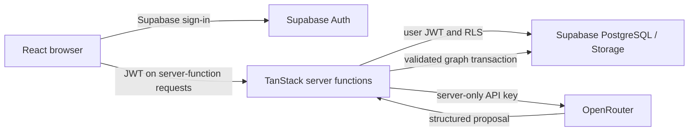

# ReversePath: simple architecture

ReversePath turns a goal into a structured plan, shows its prerequisites and next actions, and records progress and revised plans. It uses three external services: Supabase, OpenRouter, and Vercel. React and TanStack Start remain the application framework; Nitro produces the existing Node or Vercel server build.

## How requests work



The browser displays goals, plan graphs, milestones, strategies, actions, progress, and version review. It uses TanStack Query for request state and Supabase's session in local storage. Email/password and optional Google OAuth go directly through Supabase. No external auth broker is used. Local fonts keep the existing appearance without runtime font-service requests.

Supabase owns users and persistent data. Server middleware validates the user's JWT and creates a user-scoped database client. Private tables have RLS ownership policies. Ownership triggers prevent child rows from referencing another user's records. PostgreSQL functions save graphs, activate versions, update actions, and save check-ins atomically. The server secret is reserved for trusted telemetry/quotas/idempotency and disposable test-account administration; it is not the client for ordinary user data operations.

OpenRouter is the only live AI entry point. `OPENROUTER_API_KEY` and `OPENROUTER_MODEL_DEFAULT` are read in server modules. Every planning role uses that same model at the fixed official endpoint. The existing AI SDK compatible transport sends JSON-schema requests and requires a compatible endpoint. Zod checks the response, then domain validation checks the graph before persistence. Invalid output is never silently replaced with mock output in live mode. AI unavailable errors leave saved plans usable.

Deterministic code owns dependency selection, completion transitions, progress, version activation, and graph checks. `AI_PROVIDER_MODE=mock` produces labelled, deterministic proposals for tests. `/demo` is a clearly labelled offline example stored in the browser, not a Supabase or live AI proof.

## Configuration and local startup

Use Node 24 and npm. `package-lock.json` is the single package lock. The native Vite config uses the already installed TanStack, React, Tailwind, and Nitro plugins; it does not use Lovable's hosting wrapper or Cloudflare defaults.

```powershell
npm ci
if (!(Test-Path .env)) { Copy-Item .env.example .env }
# Fill the Supabase and OpenRouter values privately in .env.
npm run check:env
npm run dev
```

Open http://localhost:5173. Keep `AI_PROVIDER_MODE=mock` for no-cost development. Before real AI, run `npm run check:ai`, set `AI_PROVIDER_MODE=live` explicitly, and restart the server. Live requests use the same OpenRouter model for intake, generation, and replanning. Default timeout is 90 seconds, retries zero, output limit 12,000 tokens, and user daily operation limit 10. See [.env.example](../.env.example) and the single [environment checklist](VERCEL_ENV_SETUP.md).

Vite exposes only `VITE_*` settings in the browser bundle. Never put OpenRouter or Supabase server secrets under that prefix. The browser/server Supabase URL names share one URL; their publishable-key names share one credential. `VITE_SUPABASE_PROJECT_ID` and test-specific Supabase credentials are not required. Old local credentials are not rewritten; retired settings are ignored.

## Tests

```powershell
npm run typecheck
npm run lint
npm test
npm run build:node
npm run build:vercel
npm run test:e2e
npm audit
node scripts/scan-secrets.mjs
```

Normal tests make no paid inference calls. The mock intake/plan contracts, graph logic, and OpenRouter transport are tested deterministically. The transport regression inspects authentication, the official endpoint, JSON schema, and required capability routing without making a network call.

Opt-in real database and browser checks use the primary Supabase configuration:

```powershell
$env:AI_PROVIDER_MODE="mock"
$env:RUN_SUPABASE_RLS_TESTS="true"
npm test
$env:RUN_SUPABASE_RLS_TESTS=$null
$env:RUN_E2E_GOLDEN="true"
npm run test:e2e -- --workers=1
$env:RUN_E2E_GOLDEN=$null
```

These create unique disposable accounts, validate isolation and rollback, and delete only their own fixtures. Never run a remote reset or replay applied migrations. Explicit live test: `AI_PROVIDER_MODE=live`, `RUN_E2E_SCENARIOS=true`, then `npm run test:e2e -- tests/e2e/planning-scenarios.spec.ts --grep Career --workers=1`. That generates one real plan, verifies database persistence, completion/progress, refresh and mobile layout, then cleans up its test account. Clear gate environment variables afterward.

The public-signup test additionally requires an authorized `E2E_SIGNUP_EMAIL_TEMPLATE` containing `{runId}`. Generated confirmation links verify callback/session behavior without claiming an email reached an inbox. Real public inbox delivery still requires a manual check.

## Vercel deployment

Use the existing `reversepath-vibesprint` project, Node 24, `npm ci`, and `npm run build:vercel`. The app includes server functions; uploading a static client folder alone is insufficient. Follow [VERCEL_ENV_SETUP.md](VERCEL_ENV_SETUP.md) for Production and Preview. Test the complete candidate before production promotion, retain the previous deployment for rollback, and avoid rewriting Git history. Deployment is intentionally outside the current task.

## Common errors

| Error                              | What to check                                                                                                                  |
| ---------------------------------- | ------------------------------------------------------------------------------------------------------------------------------ |
| Sign-in unavailable                | Both public Supabase settings are present at build time; URL and key belong to the same new project                            |
| Unauthorized server request        | Valid Supabase session/JWT; global auth middleware registration; matching server URL/public key                                |
| Missing database function          | Inspect existing remote migrations; apply only reviewed missing SQL with approval, never a reset/bootstrap replay              |
| AI unavailable                     | Exact uppercase OpenRouter key name, one configured model, live mode, and enabled flag                                         |
| `AUTH_INVALID` / provider mismatch | Use an actual OpenRouter key; do not rename a key issued by another service                                                    |
| `MODEL_INCOMPATIBLE`               | Choose a catalog model supporting `structured_outputs` and `response_format`; run `check:ai`                                   |
| Rate limit or no AI credits        | OpenRouter key budget/account status and per-user application quotas; saved plans still work                                   |
| Signup email rejected/delayed      | Real disposable mailbox, Supabase Auth email restrictions and delivery setup; do not disable confirmation or repeatedly resend |
| Saved task cannot start            | Complete its dependency prerequisites first                                                                                    |

[FINAL_CONFIGURATION_REPORT.md](FINAL_CONFIGURATION_REPORT.md) records actual verification results. Older detailed architecture and release reports are labelled historical; they are not the current setup instructions.
