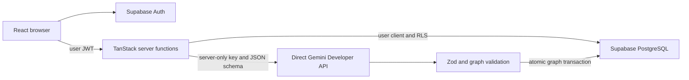

# ReversePath: simple architecture

The verified migration uses **Supabase for authentication/data, direct Gemini for AI, and Vercel for hosting**. React, TanStack Start and Nitro remain the framework/runtime. The real Free Tier Golden Path passed locally. Hosted deployment awaits the owner’s manual Vercel environment update and confirmation.

The browser never calls Gemini or receives its API key. Middleware validates Supabase JWT claims and creates the user-scoped client. RLS, ownership triggers, action prerequisites and atomic graph/version/progress operations are unchanged. Server secrets are reserved for trusted quotas, idempotency and telemetry; ordinary data uses the user's client.

The gateway explicitly creates the official Google adapter at https://generativelanguage.googleapis.com/v1beta. All roles use GEMINI_MODEL_DEFAULT; only reviewed gemini-3.8-flash is currently allowed. No second provider, paid-only model, grounding/search or external tool is configured. The pinned adapter matches the existing AI SDK provider types.

Compact prompts preserve objective, two strategies and one recommendation, milestones, dependencies, executable work, bottleneck, assumptions/risks, feasibility/confidence and replanning. Gemini 3.8 Flash's lowest supported thinking level is low; thought summaries are disabled. Existing Zod and graph checks reject invalid output before persistence. No arbitrary graph repair or validation weakening was introduced. Safe diagnostic logs contain model, token count, finish reason, schema/graph result and timeout status, without prompts, raw responses or credentials.

AI_PROVIDER_MODE=mock stays the local default. Live failures never silently become mock success. Saved plans work with Supabase connectivity even when new inference is unavailable. The demo is a separate prepared local-storage example.

Zero-cost usage requires a verified Free Tier Google project with paid billing disabled. The owner confirmed this status. The complete real Golden Path passed with gemini-3.8-flash after controlled transient retries. No billing settings changed.

Errors distinguish provider unavailability, rate limits, invalid structured output, deadlines, auth/access denial and unavailable free access. Retries default to zero; an existing optional control allows at most two retries, only for 503/429, with approximately 2/5-second backoff, jitter and Retry-After handling. Invalid output and auth failures are not retried.

Use Node 24, npm ci and the existing ignored .env. See [.env.example](../.env.example), [environment setup](VERCEL_ENV_SETUP.md), and [verification](GEMINI_VERIFICATION.md). Run check:env, check:ai, typecheck, lint, tests, build, audit and the secret scanner. Real Gemini browser acceptance is separately gated and cannot be replaced by fixture results.
